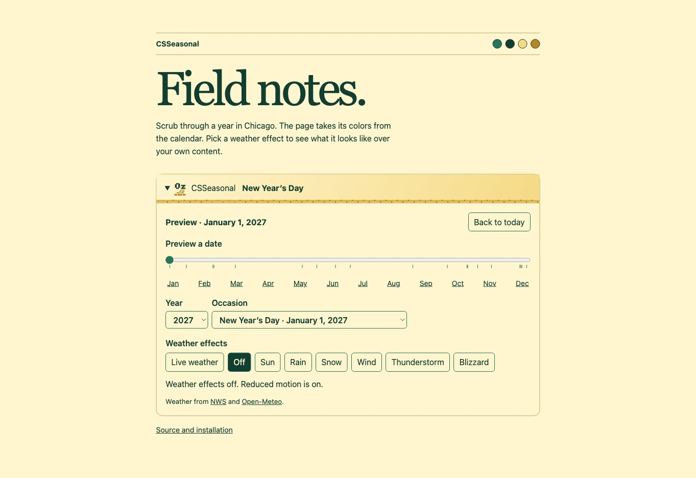

# Season Timeline

Give a website a seasonal palette that follows the date. Visitors can scrub the year, jump to an occasion, or preview weather over the viewport. The calendar, occasion artwork, and weather renderers come from Magical Minds, CivicLine and Buenos Días. The widget uses native JavaScript modules, CSS, SVG and canvas. It has no runtime dependencies.

## Try the demo

[Open the live demo on GitHub Pages](https://0xwizardof0x.github.io/season-timeline/). Try a holiday from the occasion menu, then switch between sun, rain, snow, wind and storms.



Clone this repository, run `python3 -m http.server 8000` in its root, and open <http://localhost:8000>. The root `index.html` is also ready to serve on a static host, including under a subdirectory.

## Add it to a site

Copy the entire `src/` directory into your static site, e.g. as `vendor/season-timeline/`. Keep its JS, CSS and SVG files together on the same origin. Add the following markup anywhere in the page.

```html
<script type="module" src="./vendor/season-timeline/season-timeline.js"></script>
<season-timeline page-theme></season-timeline>

<style>
  body {
    background: var(--season-page, white);
    color: var(--season-strong, #222);
  }
  a { color: var(--season-accent, #264d87); }
</style>
```

The widget exposes six CSS custom properties: `--season-page`, `--season-strong`, `--season-accent`, `--season-soft`, `--season-secondary` and `--season-border`. It also sets `data-season` and `data-occasion`. Use those values with your own typography, layout, artwork and controls. With `page-theme`, the tokens go on the document element. The default scopes them to the widget. Its controls and their styles live in a shadow root.

| Optional attribute | Behavior |
| --- | --- |
| `page-theme` | Apply the palette to the page. Use one page-level controller per document. |
| `open` | Start with the timeline controls expanded. |
| `time-zone` | IANA time zone used for local dates and automatic rollover. Defaults to `America/Chicago`. |
| `live-weather` | Enable live observations. The default offers manual previews and makes no weather requests. |
| `latitude` and `longitude` | Set both for a different observation location. Default is Chicago. |
| `station` | Optional US NWS station ID. Chicago defaults to KMDW. Custom coordinates use Open-Meteo unless you also supply a station. |
| `storage-key` | Remember the preview in session storage until the next local day. Omit for an in-memory preview. |

Set attributes before mounting. Weather data comes from the National Weather Service and Open-Meteo. Review the provider terms for your deployment when enabling live data. Unavailable or stale observations leave the manual controls usable. The widget honors reduced motion and pauses effects when the tab is hidden. The layer passes pointer events through to your page. Set `--season-weather-z` to adjust its stacking order.

## Use just the calendar

```js
import {themeFor} from './vendor/season-timeline/calendar.js';

const theme = themeFor(new Date('2026-02-14T18:00:00Z'), '', 'America/Chicago');
console.log(theme.id, theme.season, theme.palette); // valentines, winter, six color tokens
```

`themeFor(instant, preferredOccasionId, timeZone)` returns the local date, season, selected holiday, active observances, palette, label, symbol and the next boundary in epoch milliseconds. The zone defaults to Chicago. Seasons follow Northern Hemisphere meteorological months. The included calendar uses US holidays plus New Year’s Eve, Valentine's Day, Halloween, Hanukkah, both Eids and Kwanzaa. Changing time zones changes date boundaries and keeps this calendar. Single-day occasions color the preceding day and the following day too. Multi-day observances use the date ranges in `holidaysFor()`. Eid uses the Umm al-Qura planning calendar, and local observance can differ.

`occasionPoints(year)` returns the sorted timeline markers. `localDate(instant, timeZone)` and `localMidnight(isoDate, timeZone)` are available for custom controls. To follow the installed widget, listen for its bubbling `season-change` event. Its `detail` contains the same theme object.

## Development

Run `npm test` with Node 22 or newer. The package ships as static ES modules. For browser use, serve via HTTP(S) in a modern browser with native modules, Web Components, Intl calendars and CSS custom properties.

## License

MIT. See [LICENSE](./LICENSE).
